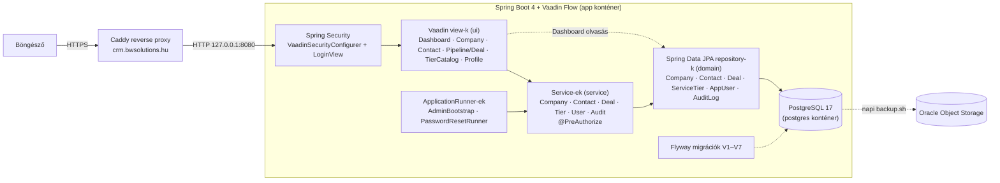
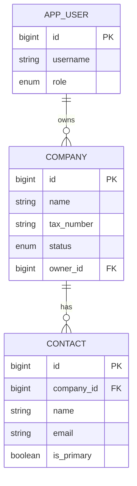

<!--
  BWCRM SHOWCASE – README VÁZ (v2)
  ------------------------------------------------------------
  - A HTML-kommentek GitHubon nem látszanak, ezek kitöltési
    útmutatók. A végén töröld őket.
  - A [szögletes zárójeles] részeket cseréld ki.
  - Írd egyes szám első személyben ("I chose…", "I ran into…").
    A konkrétum és a saját vélemény teszi hitelessé, nem a forma.
  - Ne kerüljön bele: üzleti titok, ügyféladat, belső URL,
    API-kulcs, valódi adatokat mutató képernyőkép.
-->

# BW CRM

<!--
  NYITÁS: a problémával kezdj, ne a stackkel.
  2–3 mondat: mi volt a gond, miért nem volt jó a meglévő megoldás,
  és mit csinál most a rendszer.
-->
It's also my main learning project. I started it being experienced in Java but not how production Spring applications are usually structured,
and I use it to learn that on a real problem instead of a tutorial. I wanted to stick to Java and focus mainly on the backend, so I choose the Vaadin architecture wich allows for a faster workflow.

> [!NOTE]
> The source code is private because this is a real system used by our business. This repo documents what I built and why. I'm happy to walk through the code live over screen share in an interview.

**Status:** in active development, currently at milestone [M_2] of 9 (a public demo with sample data is planned for M9).

## What's in it
 
<!-- Mit tud a rendszer és mi van benne technikailag. Ne állítsd, hogy te tervezted, ha nem így volt. -->
- Data binders, and server side front end components with Vaadin
- Authentication and role-based access with Spring Security
- Versioned database migrations, central error handling
- Docker Compose dev environment, CI that runs the tests on every push
## How I use AI on this project
 
<!--
  Légy konkrét, ne általános. Egy "I use AI responsibly" mondat
  semmit nem ér, egy valódi példa, ahol elkaptál egy hibát, sokat.
  Csak azt írd le, ami tényleg igaz a munkafolyamatodra.
-->
<!--
  Pontosan úgy írd le, ahogy dolgozol. Itt nem az a cél, hogy
  kevesebbnek tűnjön az AI szerepe, hanem hogy látsszon, mit
  tanultál belőle és mennyire érted.
-->
I build this project with Claude Code, and I use it more like a senior pair programmer than an autocomplete. Since I didn't know the common industry patterns yet, most architectural choices (layering, migrations, security setup) came from its suggestions.
 
My part:
 
- **Requirements and priorities:** The overall plan. What the system needs to do, divided into milestones.
- **Understanding before accepting:** The plan is one of the most important steps, and the beginning of the workflow. I don't commit code I can't explain. I always make sure to understand the concepts
- **Review and testing:** Review and run the tests, and do a thourugh manual testing. Push and merge only with a 100% certanty
- **Pushing back:** In some cases, even after code review by me and a subagent, there were errors found by manual testing. e.g: The concurrent modification error was caught, but the page didn't reload
- 
## What I learned
 
<!--
  A "Problems I ran into" helyett, mert ez jobban illik egy tanulóprojekthez.
  2–4 téma. Mindegyiknél: mi a minta, miért ezt javasolta a Claude Code,
  mit értettél meg belőle, mi lenne az alternatíva. A saját szavaiddal.
-->
### spring boot framework
At first it felt like complete magic. Just writing a method name in the repository and getting a working SQL query. Then I dug deeper, and learned about Hibernate, HikariCP, Spring data JPA, the spring security starter, and it all started to make sense. I still have a lot to learn but the leap in knowledge since I started working this project is huge.

### [Why entities never leave the service layer]
[What the pattern is → why it was suggested → what I understood → what would go wrong without it.]
 The pattern is the following (simplified): Vaading flow calls the service layer -> the service calls the repository -> the repository calls the postgres database.
 Simply communicating between client and database would bring severe security risks, any change is made after multiple layers of validation.
### [How Spring Security decides who can do what]
 Every AppUser has a role: USER or ADMIN. Not only can a user without the correct permission not enter a view, but it can't even call the service layer. This is done with @PreAuthorize(). 
 
### [Why database changes go through migrations]
 When changing an entity I also have to change the database, I could use Hibernates auto update, but it is unsafe and doesn't migrate data. Any changes to the database would be untracable. Flyway is a tool similar to git, but for databases. It makes it much easier to keep track of db versions.
## Stack

<!-- Csak azt írd, amit tényleg használsz. -->
| Area | Technologies |
|---|---|
| Language | Java 21 |
| Framework | Spring Boot 4.1.1: Web, Data JPA, Security, Validation, Vaadin |
| Database | PostgreSQL, Flyway migrations |
| Build | Maven / Gradle |
| Testing | JUnit 5, Mockito, Testcontainers |
| Tooling | Docker Compose, GitHub Actions|
| Frontend | Vaadin components |

## Architecture
 

<!--
  Ne tankönyvi leírás legyen: hogyan van szervezve a kód, és miért.
  A "miért"-et neked kell tudnod megindokolni interjún.
-->

## Data model (részleges)
 

## Screenshots
 
<!-- Csak kitalált adatokkal, seedelt lokális adatbázisból. Képek: docs/screenshots/ -->
| [Dashboard] | [Client list] |
|---|---|
|  |  |
 
## Testing
 
<!-- Ne csak felsorold az eszközöket: mit tesztelsz és miért így? -->
[I unit-test the service layer with Mockito and run integration tests against a real database with Testcontainers, because H2 behaved differently from production on …]
[CI runs the full test suite on every push.]
 
## What I'd do differently
 
<!--
  2–3 pont. Ebből látszik, hogy reflektálsz a saját munkádra.
  Pl. "I'd introduce migrations from day one", "I'd write the
  integration tests earlier".
-->
- [ … ]
- [ … ]
## Roadmap
 
- [x] M1 – [project setup, base architecture]
- [x] M2 – [authentication]
- [ ] …
- [ ] M9 – public demo mode with sample data
---
 
[Your Name], Computer Science BSc student at ELTE IK, looking for a Java / Spring Boot backend internship.
[LinkedIn](https://www.linkedin.com/in/[your-profile]) · [you@example.com](mailto:[you@example.com])
---

[Your Name], Computer Science BSc student at ELTE IK, looking for a Java / Spring Boot backend internship.
[LinkedIn](https://www.linkedin.com/in/[your-profile]) · [you@example.com](mailto:[you@example.com])
