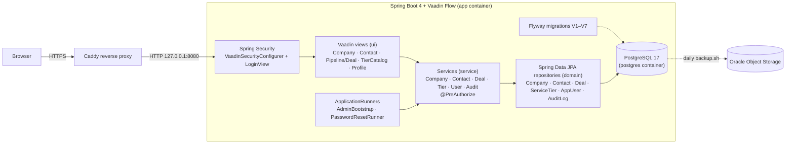
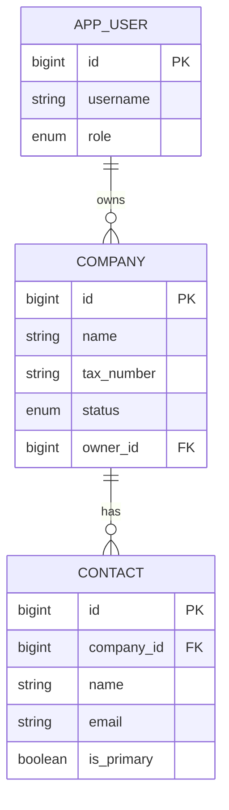
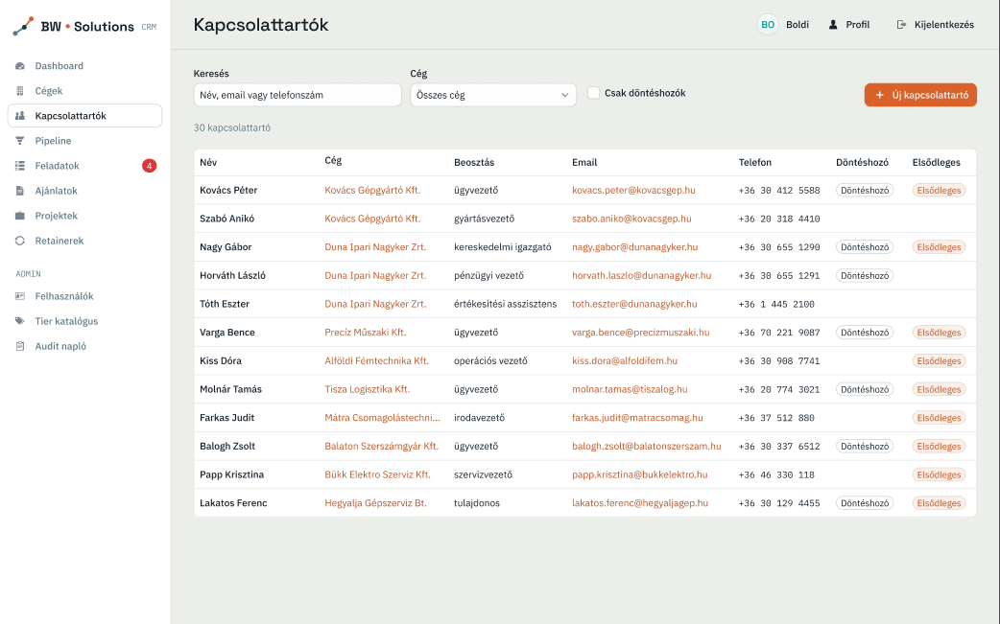

# BW CRM

We needed a customer relationship management system for our future startup, and building it ourselves was a great opportunity to test our workflow and for me to work on a real project.

It's also my main learning project. I started it with solid Java experience but without knowing how production Spring applications are usually structured, and I use it to learn that on a real problem instead of a tutorial. I wanted to stick to Java and focus mainly on the backend, so I chose Vaadin Flow, which lets me build the UI in Java without a separate JavaScript frontend.

> [!NOTE]
> The source code is private because this is a real system our team uses. This repo documents what I built and why. I'm happy to walk through the code live over screen share in an interview.

**Status:** in active development, currently at milestone M2 of 9 (a public demo with sample data is planned for M9).

## What's in it

- Companies and contacts with validation (tax number, email, phone), search and archiving
- Sales pipeline with deals and a service tier catalog
- Key events go into a separate append-only audit log
- Server-side UI with Vaadin components and data binding
- Authentication and role-based access with Spring Security
- Versioned database migrations and central error handling
- Docker Compose dev environment and CI that runs the full test suite on every pull request and every push to main.

## Deployment

An early version already runs on an Oracle Cloud VPS:

- The application and PostgreSQL 17 run in separate Docker containers, managed with Docker Compose.
- Caddy sits in front as a reverse proxy and handles HTTPS certificates automatically. The application itself only listens on localhost, so it can't be reached from outside except through Caddy.
- Flyway applies database migrations automatically on startup.
- A daily backup script uploads a database dump to Oracle Object Storage.

## How I use AI on this project

I build this project with Claude Code, and I use it more like a senior pair programmer than an autocomplete. Since I didn't know the common industry patterns yet, most architectural choices (layering, migrations, security setup) came from its suggestions.

My part:

- **Requirements and priorities:** the overall plan, which is the most important step and the start of the workflow: what the system needs to do, divided into milestones with acceptance criteria.
- **Understanding before accepting:** I don't commit code I can't explain, and I always make sure I understand the concepts behind it.
- **Review and testing:** I review every change, run the tests and do thorough manual testing. I only merge once I'm confident it works.
- **Manual testing:** sometimes manual testing finds bugs that code review missed, both mine and an AI review agent's. For example, when two users edited the same company, optimistic locking correctly rejected the second save, but the page kept showing stale data until a manual reload. Neither review caught it.

## What I learned

### Spring Boot is less magic than it looks
At first it felt like complete magic: I wrote a method name in a repository and got a working SQL query. Then I dug deeper and learned about Hibernate, HikariCP, Spring Data JPA and the Spring Security starter, and it all started to make sense. I still have a lot to learn, but the leap in knowledge since I started working on this project is huge.

### Why the UI always goes through the service layer
The pattern is the following (simplified): Vaadin views call the service layer → the service calls the repository → the repository talks to the PostgreSQL database. No view talks to a repository directly.
Keeping every change in the service layer means transactions, validation and permission checks (`@PreAuthorize`) live in one place, so no view can skip them by accident.

### How Spring Security decides who can do what
Every `AppUser` has a role: USER or ADMIN. A user without the right permission not only can't open a view, they can't even call the service layer behind it. This is done with `@PreAuthorize`.

### Why database changes go through migrations
When I change an entity, I also have to change the database. I could use Hibernate's auto-update, but it's unsafe, it doesn't migrate existing data, and the changes would be untraceable. Flyway works like version control for the database schema, so it's easy to see which version the database is at and how it got there.

### How to deploy
I learned how to set up a VPS on Oracle Cloud, create storage buckets for backups, configure Caddy for HTTPS, and get the application from my machine running on a server.

## Stack

| Area | Technologies |
|---|---|
| Language | Java 21 |
| Framework | Spring Boot 4.1.1: Web, Data JPA, Security, Validation,|
| Database | PostgreSQL 17, Flyway migrations |
| Build | Maven |
| Testing | JUnit 5, Mockito, Testcontainers |
| Tooling | Docker Compose, GitHub Actions |
| Frontend | Vaadin 25.3 |
| Hosting | Oracle Cloud VPS, Caddy, Oracle Object Storage |

## Architecture

## Data model (simplified)

## Screenshots

| Companies | Contacts | Pipeline |
|---|---|---|
|  |  |  |

## Testing

I unit-test the service layer with Mockito and run integration tests against a real database with Testcontainers. CI runs the full test suite on every push.
Views are tested with Vaadins browserless-tests.

## Roadmap

| # | Milestone |
|---|---|
| M0 | Foundations |
| M1 | Companies and contacts |
| M2 | Pipeline |
| M3 | Activities and tasks |
| M4 | Proposals |
| M5 | Projects and payment schedules |
| M6 | Retainers |
| M7 | Dashboard |
| M8 | User management and audit log |
| M9 | Demo mode and production launch |

## What I'd do differently

- I'd take it a bit slower at the start. First I coded a simple CRM by hand, and I underestimated how much more a production-grade application involves. It was very overwhelming at first.
- I'd start sooner. This project has taught me so much and it's very exciting; I only wish I had started earlier.

---

Majer Balázs, Computer Science BSc student at ELTE IK, looking for a Java / Spring Boot backend internship.
[LinkedIn](https://www.linkedin.com/in/majer-balázs) · [majerbalazs05@gmail.com](mailto:majerbalazs05@gmail.com)
